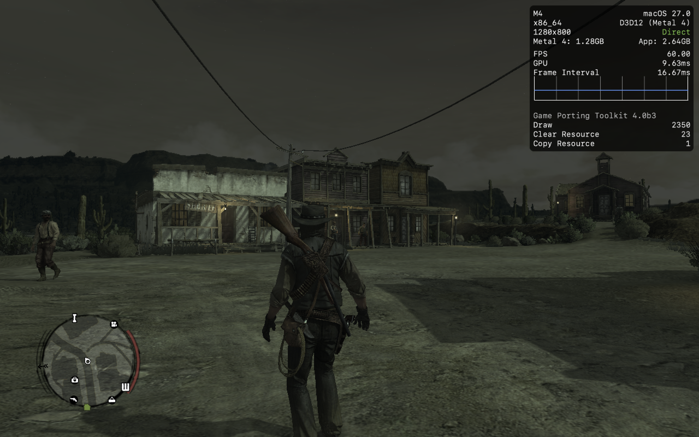

# WineWrap

> !!! This project is vibe coded 🤖

A CrossOver-style front end for [Wine](https://www.winehq.org/), written in Rust,
for running Steam and Windows games on macOS.

WineWrap can download and install Wine for you (no Homebrew needed), or use
the Wine builds you already have (Apple's Game Porting Toolkit, any `Wine *.app`
in Applications, Homebrew, Whisky's Wine). It manages **bottles** for them. A bottle is an isolated Windows environment
(a `WINEPREFIX`) with its own settings. On top of that it can install Steam and
launch your games.

| Feature | |
|---|---|
| Wine | one-click install of stable/devel/staging builds; auto-detects GPTK, `Wine *.app` bundles, Homebrew, Whisky, custom paths |
| Bottles | create, configure, delete; Windows version, Retina mode |
| Graphics | D3DMetal (GPTK), DXVK (MoltenVK), WineD3D |
| Performance | MSync / ESync, Rosetta AVX advertising, Metal HUD |
| Steam | one-click install, launch, installed-games list, play by app ID |
| Front ends | desktop app (`WineWrap`) and CLI (`winewrap`) |

## Requirements

* macOS 13+ (Apple Silicon or Intel). Linux works for development and with a system Wine.
* **Rosetta 2** on Apple Silicon. The app offers to install it if it's missing.
* **Wine.** If none is found, click **Install Wine** in the app, or run
  `winewrap runtime install`. This downloads a prebuilt macOS Wine from
  [Gcenx/macOS_Wine_builds](https://github.com/Gcenx/macOS_Wine_builds) (the same
  builds Homebrew's `wine-stable` cask uses) into WineWrap's own folder.

  For DirectX 12 games, you need Apple's D3DMetal (DirectX 12 → Metal). Its
  license forbids redistribution, so WineWrap doesn't bundle it: download the
  [Game Porting Toolkit](https://developer.apple.com/games/game-porting-toolkit/)
  yourself and graft D3DMetal into a runtime (see
  [DirectX 12 with D3DMetal](#directx-12-with-d3dmetal)).

## Building

```bash
cargo build --release
```

This produces `target/release/winewrap` (CLI) and `target/release/winewrap-gui` (GUI).
To build a double-clickable `WineWrap.app` in a `.dmg`, plus a CLI tarball,
run this on a Mac. It writes to `dist/`:

```bash
scripts/package-macos.sh            # universal (Apple Silicon + Intel)
```

```bash
scripts/package-macos.sh native     # current architecture only, faster
```

Prebuilt downloads are attached to each
[GitHub release](https://github.com/hashspace-apps/wine-wrap/releases). The latest
build of `master` is always available as the
[`dev-unsigned` pre-release](https://github.com/hashspace-apps/wine-wrap/releases/tag/dev-unsigned).
To publish one from another branch, run the CI workflow manually (Actions → CI →
Run workflow). Builds are shared as release files, not Actions artifacts, so they
don't use the account's artifact storage.

### Running an unsigned build

Builds without an Apple Developer ID are *ad-hoc signed*. They run normally, but
macOS Gatekeeper blocks apps downloaded from the internet that Apple has not
notarized. On macOS 15 and later, right-click → Open no longer bypasses this.
After downloading:

1. Download `WineWrap-*.dmg` from the release, open it and
   drag **WineWrap** to **Applications**.
2. Remove the quarantine flag once:

   ```bash
   xattr -dr com.apple.quarantine /Applications/WineWrap.app
   ```

   Alternatively, open the app once, then go to **System Settings → Privacy &
   Security** and click **Open Anyway**.
3. Optional: put the bundled CLI on your `PATH`:

   ```bash
   sudo ln -sf /Applications/WineWrap.app/Contents/Helpers/winewrap /usr/local/bin/winewrap
   ```

For the standalone CLI tarball, run `xattr -d com.apple.quarantine ./winewrap` after extracting it.

## Quick start (CLI)

```bash
winewrap doctor                # check Rosetta, Wine runtimes, …
winewrap runtime install       # download Wine (stable; or: devel, staging)
winewrap steam install         # creates a "Steam" bottle and installs Steam
winewrap steam launch          # sign in and install games
winewrap steam games           # list installed games with their app IDs
winewrap steam play 620        # launch a game by app ID
```

Other commands:

```bash
winewrap runtime list
winewrap runtime add gptk /usr/local/opt/game-porting-toolkit
winewrap runtime default gptk

winewrap bottle create Games --graphics dxvk --windows win10 --retina
winewrap bottle set Games metal_hud true
winewrap bottle set Games env.DXVK_HUD fps
winewrap bottle install-dxvk Games ~/Downloads/dxvk-macOS-async-v1.10.3
winewrap bottle show Games
winewrap run Games ~/Downloads/setup.exe
winewrap winecfg Games
winewrap kill Games
```

Add `--dry-run` to any command to print the Wine command lines it would run
instead of running them. Add `-v` or `-vv` for more logging.

## Where things live

| What | macOS location |
|---|---|
| Settings | `~/Library/Application Support/com.wine-wrap.WineWrap/config.toml` |
| Bottles | `~/Library/Application Support/com.wine-wrap.WineWrap/bottles/<name>/` |
| Managed runtimes | `~/Library/Application Support/com.wine-wrap.WineWrap/runtimes/<name>/` |
| Logs | `~/Library/Application Support/com.wine-wrap.WineWrap/logs/` |
| Downloads | `~/Library/Caches/com.wine-wrap.WineWrap/downloads/` |

Set `WINEWRAP_HOME=/some/dir` to keep everything under one directory, for
example on an external drive.

Each bottle is a normal Wine prefix with a `bottle.toml` next to `drive_c`:

```toml
name = "Steam"
windows_version = "win10"
graphics = "d3dmetal"   # d3dmetal | dxvk | wined3d
sync = "msync"          # msync | esync | none
retina = false
metal_hud = false
advertise_avx = false
dxvk_async = false
steam_args = []

[env]
# Extra environment variables for every process in the bottle.

[drives]
# Game folders outside the bottle, as Windows drive letters (D: to Y:):
# d = "/Volumes/SSD/SteamLibrary"
```

### Installing games on another disk

In the app, open the bottle's settings, click **Game folders → Add folder…**,
pick a folder (e.g. `/Volumes/SSD/SteamLibrary`) and Save. Or:

```bash
winewrap bottle set Steam drive.d /Volumes/SSD/SteamLibrary
```

Windows programs see the folder as a drive, and in a Steam bottle it becomes a
Steam library the next time Steam starts, so it shows up in Steam's install
dialog. The disk should be formatted APFS or Mac OS Extended: macOS can't
write to NTFS, and exFAT works but is slower. While the disk is unplugged,
Steam shows the games on it as not installed.

## DirectX 12 with D3DMetal

Modern DirectX 12 games (Unreal Engine 5 and similar) need Apple's D3DMetal to
translate Direct3D 12 to Metal. WineWrap's own Wine build ships vkd3d over
MoltenVK, which only reaches Direct3D feature level 11_0 — enough to create a
device, but not to run feature-level-12 games. D3DMetal reaches feature level
12.

Apple's license doesn't allow redistributing D3DMetal, so you supply it:

1. Download the
   [Game Porting Toolkit](https://developer.apple.com/games/game-porting-toolkit/)
   (free with an Apple ID). Open the `.dmg`, then open the
   **Evaluation environment for Windows games** image inside it to mount it. You
   don't have to install anything else — the graft copies what it needs.
2. Graft D3DMetal into the runtime a bottle uses (for Steam bottles that's the
   managed `wine-winewrap-*` build), pointing at the mounted volume:

   ```bash
   winewrap runtime install-d3dmetal wine-winewrap-26.3.0-4 "/Volumes/Evaluation environment for Windows games 4.0 beta 3"
   ```

   You can eject the images afterwards: everything D3DMetal needs is copied into
   the build.

3. Switch the bottle's graphics backend to D3DMetal:

   ```bash
   winewrap bottle set Steam graphics d3dmetal
   ```

This copies `D3DMetal.framework`, `libd3dshared.dylib` and the D3DMetal
`d3d12`/`dxgi` DLLs into the build, next to (not over) Wine's own. Games get
D3DMetal; a few programs it can't serve, such as the Rockstar Games Launcher,
keep Wine's Direct3D. To undo the graft, run
`winewrap runtime remove-d3dmetal <runtime>`.

## Tested games

Games tried on an M4 Mac with WineWrap's own Wine build, from a Steam bottle.

| Game | Status | Graphics | Notes |
| --- | --- | --- | --- |
| Red Dead Redemption | ✅ Works | D3DMetal (Game Porting Toolkit 4.0 beta 3) | Starts from Steam through the Rockstar Games Launcher, signs in to Social Club, and plays at 60 FPS (1280×800). An Xbox Wireless Controller works. Needs Wine patches 0004 and 0005. |
| Phantom Blade Zero | ❌ Doesn't work | D3DMetal | Crashes inside its Denuvo DRM before rendering anything. It fails in CrossOver too. |



## Troubleshooting

* **Steam window is black**: a known limitation of upstream Wine on macOS
  (tested with 11.0 and 11.20). Steam's UI renders, but Chromium draws it from a
  helper process into a window another process owns, and Wine's macOS driver
  doesn't show that. Steam arguments such as `-cef-disable-gpu` don't help.
  WineWrap's own Wine build fixes it, and Steam bottles switch to it
  automatically (downloading it the first time); see
  [Building Wine for Steam](#building-wine-for-steam).
* **A game says your CPU lacks AVX**: on macOS 15 or later, enable `advertise_avx`.
* **Nothing happens on launch**: check the newest file in the logs directory, or
  run the command printed by `--dry-run` yourself with `WINEDEBUG=+err` set.

## Building Wine for Steam

`scripts/build-wine-macos.sh` builds an x86_64 macOS Wine from CodeWeavers'
LGPL [CrossOver source](https://www.codeweavers.com/crossover/source) (Wine 11.0
base) plus the patches in `scripts/wine-patches/`, which make Steam's UI show.
Wine's Windows-side DLLs are compiled with a MinGW GCC toolchain that the script
also builds: with clang (llvm-mingw), Steam never connects to its servers.
It needs Xcode (and Rosetta on Apple Silicon), but no Homebrew or MacPorts:
every dependency is downloaded with a pinned checksum and built into the work
directory. A first build takes about an hour; the toolchain is reused after that.

Installing Steam, launching it, or playing a game moves a Steam bottle onto this
build, downloaded from this repository's releases (`wine-winewrap-<version>`).
Bottles pinned to GPTK or a custom Wine are left alone.

```bash
scripts/build-wine-macos.sh        # writes target/wine-build/wine-winewrap-*-osx64.tar.xz
```

To use a local build instead, extract it and register it as a runtime for your Steam bottle:

```bash
tar xJf target/wine-build/wine-winewrap-*-osx64.tar.xz -C ~/Applications
winewrap runtime add winewrap-cx ~/Applications/"Wine WineWrap.app"
winewrap bottle set Steam runtime winewrap-cx
```

## Project layout

```
crates/
  winewrap-core/   library: runtimes, bottles, launch environment, Steam, VDF parser
  winewrap-cli/    `winewrap` command-line tool (clap)
  winewrap-gui/    `WineWrap` desktop app (egui/eframe)
```

The core library expresses every operation as a `LaunchSpec` (program,
arguments, environment and working directory) before running it. That keeps
the logic unit-testable without Wine installed, and both front ends share it.

```bash
cargo test --workspace
cargo clippy --workspace --all-targets
```

## CI/CD

GitHub Actions workflows live in `.github/workflows/`:

| Workflow | Runs on | Does |
|---|---|---|
| `ci.yml` | every push to `master`, every pull request, manual runs | `cargo fmt --check`; clippy on macOS and Linux; tests on macOS arm64, macOS x86_64 and Linux; a minimum Rust version check (1.88 for core/CLI, 1.95 for the GUI); `cargo deny` (licenses, RustSec advisories, crate sources); then builds the universal `.dmg`, launches it on a Mac runner as a smoke test, and (on `master` or manual runs) publishes it as the `dev-unsigned` pre-release |
| `release.yml` | pushing a `v*.*.*` tag | checks that the tag matches `Cargo.toml`, runs CI, builds the macOS `.dmg`, the macOS CLI tarball and a Linux CLI tarball, uploads them to a draft GitHub release and publishes it with `SHA256SUMS.txt` |

Dependabot (`.github/dependabot.yml`) opens weekly update PRs for crates and actions.

### Cutting a release

1. Bump `version` in the root `Cargo.toml` and run `cargo check` so `Cargo.lock` updates.
2. Commit, then tag and push:

```bash
git tag v0.2.0
```

```bash
git push origin v0.2.0
```

Tags with a suffix such as `v0.2.0-beta.1` are published as pre-releases.

### Code signing (optional)

Without signing secrets, builds are ad-hoc signed (see
[Running an unsigned build](#running-an-unsigned-build)). To ship a signed and
notarized app that opens without warnings, add these repository secrets:

| Secret | Value |
|---|---|
| `MACOS_CERTIFICATE_P12` | base64 of your *Developer ID Application* certificate exported as `.p12` |
| `MACOS_CERTIFICATE_PASSWORD` | password of that `.p12` |
| `MACOS_SIGNING_IDENTITY` | e.g. `Developer ID Application: Your Name (TEAMID)` |
| `APPLE_ID`, `APPLE_TEAM_ID`, `APPLE_APP_PASSWORD` | for notarization; use an app-specific password |

## License

MIT. See [LICENSE](LICENSE).
