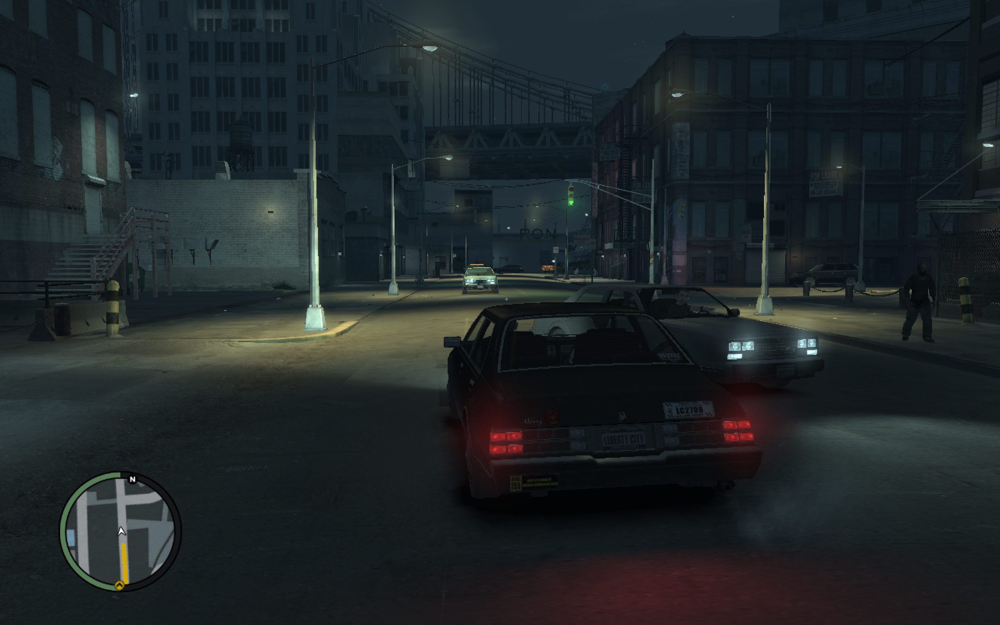

  

<h1 align="center">WineWrap</h1>

  <b>在 Mac 上玩 Windows 版 Steam 游戏。</b> 
  免费、开源。不需要 Windows，也不需要 Boot Camp。

  <a href="https://github.com/hashspace-apps/wine-wrap/releases"><b>⬇ 下载 macOS 版</b></a>
  ·
  <a href="README.md">English</a>

<i>《荒野大镖客》（Red Dead Redemption）在 M4 Mac 上以 60 FPS 运行，使用 Xbox 手柄。</i>

> [!NOTE]
> 本项目是 vibe coding 🤖 写出来的，还很年轻，难免有不完善的地方。
> 不管游戏能不能玩，都欢迎反馈给我们。

## 这是什么？

WineWrap 是一个 Mac 应用，可以运行 Windows 版的 Steam，让你安装并游玩只有
Windows 版的游戏。所有东西它都会帮你配好：不用打开终端，也不用装 Homebrew。

* **一键装好 Steam。** 点击 **Install Steam**，登录账号，下载游戏。
* **每个游戏都有 Play 按钮。** 已安装的 Steam 游戏会显示在应用里，可以直接从
  这里启动，也可以从 Steam 启动。
* **支持 DirectX 12 游戏**，借助 Apple 的 D3DMetal（来自 Apple 免费的 Game
  Porting Toolkit，见 [DirectX 12 游戏](#directx-12-游戏)）。
* **支持手柄**，比如 Xbox 无线手柄。
* **游戏多也不怕，可以装到外置 SSD。** 添加一个文件夹，Steam 就能把游戏装到那里。
* **FPS 显示。** 在容器设置里打开 Metal 性能 HUD 即可。
* **容器（Bottle）** 让游戏互不干扰：每个容器都是一台独立的"小 Windows 电脑"，
  一个游戏出问题不会影响其他游戏。

WineWrap 底层使用 [Wine](https://www.winehq.org/)（CrossOver 里用的也是这项开源
技术），并加入了自己的修复，让 Steam 窗口和 Rockstar 游戏能正常工作。

## 快速上手

需要 **macOS 13 或更高版本** 的 Mac。Apple 芯片（M1–M4）和 Intel 芯片都可以。

1. **下载**：从[最新版本](https://github.com/hashspace-apps/wine-wrap/releases)
   下载 `WineWrap-*.dmg`，打开后把 **WineWrap** 拖进 **应用程序（Applications）**
   文件夹。
2. **允许打开**：WineWrap 目前还没有经过 Apple 签名，所以第一次打开时 macOS 会
   阻止它。先尝试打开一次，然后进入 **系统设置 → 隐私与安全性**，点击
   **仍要打开**。（也可以在终端里运行
   `xattr -dr com.apple.quarantine /Applications/WineWrap.app`。）
3. **安装 Steam**：点击 **⬇ Install Steam**。WineWrap 会自动下载 Wine 和 Steam；
   在 Apple 芯片的 Mac 上，如果缺少 Rosetta 2，它也会提示你安装。
4. **开玩**：点击 **▶ Launch Steam**，登录，安装游戏，然后点 **▶ Play**。

如果 Steam 在局域网传输游戏时找不到你的其他电脑，请到 **系统设置 → 隐私与安全性
→ 本地网络** 中，确认已允许 WineWrap 和 Wine。

> [!TIP]
> 如果 Steam 下载很慢，可以在 Steam 的 **设置 → 下载 → 下载地区** 里换一个离你
> 更近的服务器。

## 已测试的游戏

在 M4 Mac 上测试。

| 游戏 | 能玩吗？ | 说明 |
| --- | --- | --- |
| 荒野大镖客（Red Dead Redemption） | ✅ 能 | 60 FPS。需要 D3DMetal。通过 Rockstar Games 启动器启动；Social Club 登录和 Xbox 手柄都正常。 |
| 侠盗猎车手 IV：完全版（Grand Theft Auto IV: The Complete Edition） | ✅ 能 | 通过 Rockstar Games 启动器启动。它的设置和存档放在容器自己的"文档"文件夹里，不会碰你 Mac 上的 `~/Documents`。 |
| 影之刃零（Phantom Blade Zero） | ❌ 不能 | 它的 Denuvo DRM 在游戏画面出现前就崩溃了（在 CrossOver 里也一样）。 |

<i>《侠盗猎车手 IV》在 M4 Mac 上运行。</i>

试了别的游戏？欢迎[提交 issue](https://github.com/hashspace-apps/wine-wrap/issues)
告诉我们结果（中文、英文都可以）。

## DirectX 12 游戏

较新的游戏（比如虚幻引擎 5 的游戏）需要 **D3DMetal**，也就是 Apple 的 DirectX 12
转译层。Apple 不允许别人分发它，所以需要你自己下载一次：

1. 下载 [Game Porting Toolkit](https://developer.apple.com/games/game-porting-toolkit/)
   （用 Apple ID 登录即可免费下载）。
2. 打开下载的 `.dmg`，再打开里面的 **Evaluation environment for Windows games**
   磁盘映像。
3. 在 WineWrap 的容器里点击 **Add D3DMetal…**，选择这个磁盘。完成后就可以推出
   磁盘了。

## 常见问题

* **游戏提示 CPU 不支持 AVX**：打开容器的 **Settings（设置）**，开启
  **Advertise AVX to games**（需要 macOS 15 或更高版本）。
* **Steam 窗口一片黑**：说明这个容器没有在用 WineWrap 自己编译的 Wine。从应用里
  安装或启动 Steam 会自动切换过去。
* **点了 Play 没反应**：打开窗口底部的 **Activity（活动）** 查看，或者查看
  `~/Library/Application Support/com.wine-wrap.WineWrap/logs/` 里最新的日志文件。

---

命令行工具、文件位置、从源码编译等面向高级用户和开发者的内容，请看
[英文 README](README.md#for-power-users-and-developers)。

## 许可证

MIT，见 [LICENSE](LICENSE)。
